  

  
  
  
  
  
  

  I build AI features and full-stack SaaS that hold up in production: tool-calling agents, RAG over real documents,
  <b>MCP servers</b> that let Claude and Cursor act on business data, and the Next.js + Postgres apps around them.

 

## Featured work

### Savora — a restaurant operating system with an AI copilot and an MCP server

One platform for the whole restaurant — **POS, kitchen display, QR and online ordering, floor plan, reservations, menu and recipe costing, inventory, purchasing, staff rota and timesheets, loyalty, reviews, finance and reports** — with an **AI copilot** that answers from live data through 21 audited tools, and an **MCP server + REST API** that expose the same tools to Claude, Cursor and your own scripts. Multi-tenant and multi-location, six server-enforced roles, every change in the audit log. The landing page is a scroll-driven 3D walkthrough of the demo restaurant built in React Three Fiber, with no 3D assets.

<table>
  <tr>
    <td width="50%"></td>
    <td width="50%"></td>
  </tr>
  <tr>
    <td align="center">Tablet-first POS — one order flows to the kitchen display, the floor plan and stock</td>
    <td align="center">AI copilot: menu engineering on 30 days of sales, every number from a tool call</td>
  </tr>
</table>

  
  
  
  
  
  
  
  
  
  
  
  
  

**23 back-office screens · 51 routes · 123 automated tests · 21 AI & MCP tools · demo seeded with 46 dishes, 2 branches and 30 days of history**

**[Live demo](https://savora-six-beta.vercel.app)** — try it as the owner, the head chef, a server or the host, no sign-up · **[Source](https://github.com/itx-Champion/savora)** · [Architecture notes](https://github.com/itx-Champion/savora/blob/main/docs/ARCHITECTURE.md)

 

### Lumora — AI agent, CRM and help desk

An AI agent that answers from company documents **with citations** and acts on a multi-tenant Postgres CRM: a support inbox with SLAs, auto-triage and knowledge-grounded AI replies, a drag-and-drop pipeline with weighted forecast, explainable lead scores and an AI morning briefing. Admins get five server-enforced roles, "view as" impersonation, no-code automations and an audit log. A REST API and an **MCP server** let Claude or Cursor work with the CRM using scoped API keys.

<table>
  <tr>
    <td width="50%"></td>
    <td width="50%"></td>
  </tr>
  <tr>
    <td align="center">The agent finds a contact and creates a follow-up task through tool calls</td>
    <td align="center">Help desk with SLAs, auto-triage and AI replies grounded in the knowledge base</td>
  </tr>
</table>

  
  
  
  
  
  
  
  
  
  

**[Live demo](https://lumora-ai-agent.vercel.app)** — every visitor gets a private sandbox workspace · **[Source](https://github.com/itx-Champion/lumora)**

 

### Cyber Store — a production-style e-commerce storefront

<table>
  <tr>
    <td width="62%"></td>
    <td width="38%" valign="top">
      Electronics storefront with URL-synced filters, <kbd>Ctrl</kbd> <kbd>K</kbd> search, a cart drawer, validated guest checkout and order history, CI-tested.  
      
      
      
        
      <b><a href="https://cyber-e-commerce-blond.vercel.app">Live demo</a></b> · <a href="https://github.com/itx-Champion/cyber-e-commerce">Source</a>
    </td>
  </tr>
</table>

> Savora and Lumora are my own products, built to production standards and documented as case studies. The companies, staff, guests and reviews inside the demos are fictional.

 

## What I build

| | |
|---|---|
| 🤖 **AI agents & LLM integrations** | Tool-calling agents and multi-step workflows (OpenAI, Claude, Gemini), RAG and knowledge-base assistants over your documents, AI copilots inside existing apps |
| 🔌 **MCP servers & AI APIs** | MCP servers that connect Claude, Cursor and ChatGPT to internal APIs and databases, with scoped keys, permissions and audit logs; the same tools exposed over REST |
| 🧱 **Full-stack SaaS** | MVPs, dashboards, admin panels and internal tools; Next.js / React in TypeScript; Node.js APIs; PostgreSQL, MongoDB and Supabase; auth, roles, billing, multi-tenancy |
| ⚙️ **Automation & CRM** | API, webhook and third-party integrations; lead capture, qualification, routing and follow-ups; AI content and reporting pipelines; BullMQ job queues |
| 🎙️ **Voice AI** | Voice agents and real-time voice features with ElevenLabs, LiveKit and GoHighLevel |
| 🛠️ **Debugging & rescue** | Fixing broken integrations, failing AI features, and slow or unstable Node.js / Next.js apps |

Day to day I also work on a multi-tenant construction-management SaaS (Node.js/Express, MongoDB, Redis/BullMQ, React/TypeScript), where I build MCP servers and tools that let AI agents act on real business data, integrate agent frameworks, work with vector search, and build real-time voice features with LiveKit.

 

## How I work

- **Start from the business problem** — what should happen, for whom, and how we will know it works. AI goes only where it pays off.
- **Production habits from day one** — typed code, server-side authorization, tests that run in CI, error handling and retries instead of silent failures.
- **Clear scope and milestones** — regular progress updates and a working demo before handoff.
- **Documentation and a proper handover** — architecture notes and setup instructions so your team can run and extend what I build.

 

## Toolbox

  
  
  
  
  
  

  
  
  
  
  
  

  
  
  
  
  
  
  
  

  
  
  
  
  
  
  
  

 

## Let's build something

**Good fit:** founders building an MVP or SaaS, product teams adding AI to an existing app, agencies that need a dependable developer, and businesses automating lead handling or internal workflows.

Send me a short message with what you're building (or what's broken), your stack and your timeline.

  
  
  

